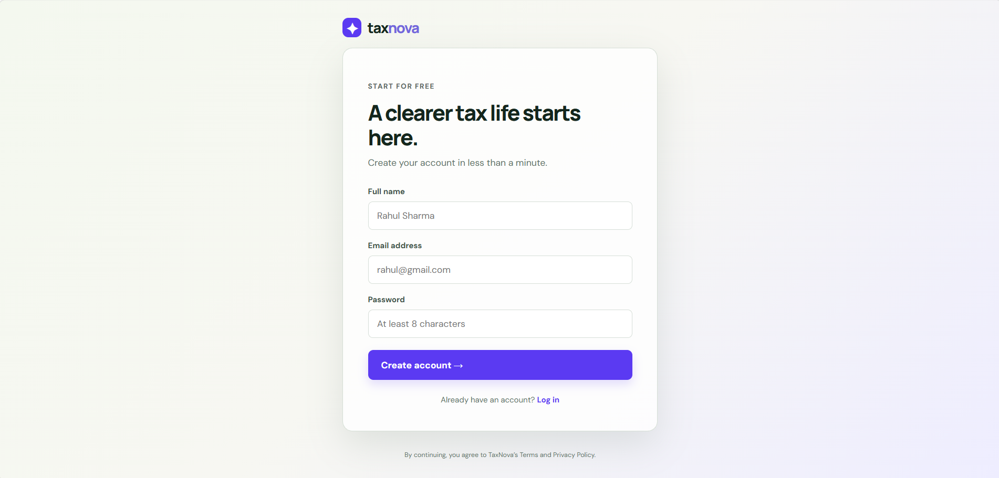
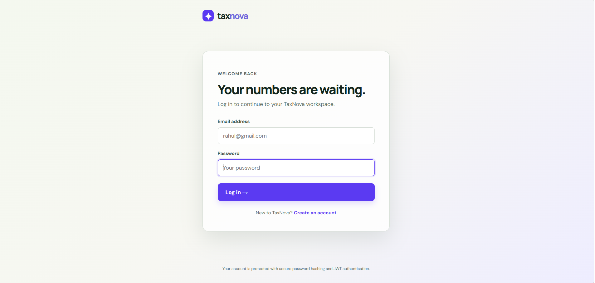
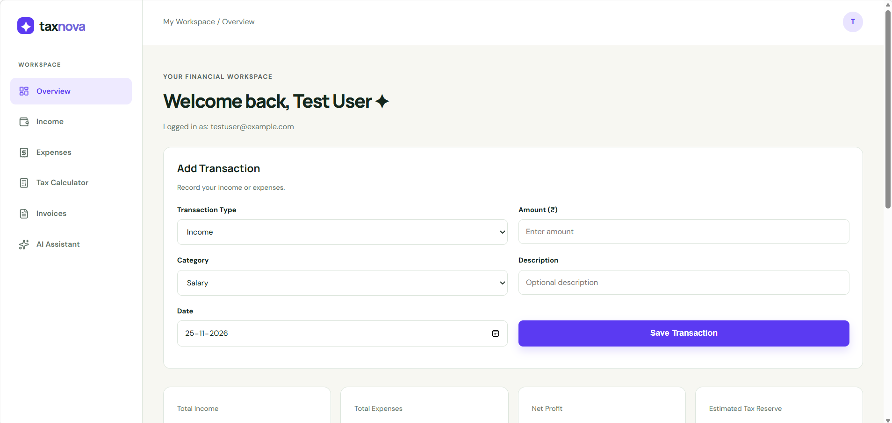
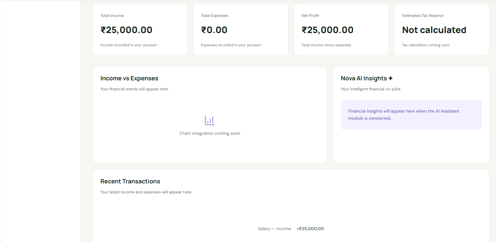

# TaxNova — Intelligent Financial & Tax Management Platform


## Project Overview

TaxNova is a full-stack financial management and tax
assistance platform designed to help individuals,
freelancers, and small businesses manage their finances
through a centralized digital workspace.

The platform aims to simplify income tracking, expense
management, tax estimation, invoice generation, and
financial decision-making.

TaxNova is currently under active development.

## Implemented Features

- User registration and login
- Password hashing using bcrypt
- JWT-based authentication
- Protected dashboard and API endpoints
- MySQL database integration
- Income and expense recording
- Automatic financial summary calculations
- Net profit calculation
- Recent transaction history
- User-specific financial records
- Responsive user interface
- REST API integration

## Upcoming Features

- Dedicated income and expense management modules
- Edit and delete transactions
- Interactive financial charts
- Indian income tax calculator
- Tax estimation and planning
- Invoice generation and management
- AI-powered financial assistant
- Downloadable financial reports
- Cloud deployment

## Technology Stack

| Layer | Technologies |
|-------|--------------|
| Frontend | HTML5, CSS3, JavaScript, React.js |
| Backend | Node.js, Express.js |
| Database | MySQL |
| Authentication | JWT, bcrypt |
| API | REST API |
| Security | Helmet, CORS, Rate Limiting |
| Version Control | Git, GitHub |
| Development Tools | VS Code, MySQL Workbench |

## System Architecture

```text
User
  |
  v
Frontend (HTML, CSS, JavaScript, React)
  |
  | REST API / JWT Authentication
  v
Backend (Node.js + Express.js)
  |
  | Parameterized SQL Queries
  v
MySQL Database
```

## Project Structure

```text
TaxNova/
├── database/
│   └── schema.sql
├── js/
│   ├── apiClient.js
│   ├── login.js
│   ├── register.js
│   └── dashboard.js
├── server/
│   ├── config/
│   ├── controllers/
│   ├── middleware/
│   ├── routes/
│   ├── services/
│   └── index.js
├── screenshots/
├── index.html
├── login.html
├── register.html
├── dashboard.html
├── styles.css
├── .env.example
├── .gitignore
├── package.json
└── README.md
```

## REST API Endpoints

| Method | Endpoint | Description |
|--------|----------|-------------|
| GET | /api/health | API health check |
| POST | /api/auth/register | Register a user |
| POST | /api/auth/login | Authenticate a user |
| GET | /api/auth/me | Retrieve authenticated user |
| GET | /api/transactions | Retrieve user transactions |
| POST | /api/transactions | Create a transaction |

## Installation and Setup

### Prerequisites

- Node.js and npm
- MySQL Server
- Git
- VS Code with Live Server extension

### 1. Clone the repository

```bash
git clone https://github.com/Payal-hue/TaxNova.git
cd TaxNova
```

### 2. Install dependencies

```bash
npm install
```

### 3. Configure environment variables

Create a `.env` file in the root directory using
`.env.example` as a reference.

Configure your MySQL credentials and generate a secure
JWT secret.

Never commit your actual `.env` file.

### 4. Configure the database

Create a MySQL database named `taxnova`.

Execute the SQL statements available in:

```text
database/schema.sql
```

### 5. Start the backend server

```bash
node server/index.js
```

The backend runs at:

http://localhost:3000

### 6. Start the frontend

Open `index.html` using the VS Code Live Server extension.

http://127.0.0.1:5500/index.html

Ensure the frontend URL matches the CLIENT_ORIGIN
configured in your `.env` file.

## Security Implementation

- Password hashing using bcrypt
- JWT-based session verification
- Protected financial API endpoints
- User-specific transaction access
- Parameterized SQL queries
- Environment-based secret management
- API rate limiting
- HTTP security headers


## Project Screenshots

### Landing Page


### User Registration


### User Login


### Financial Dashboard


### Transaction Management


## Development Roadmap

- [x] Project planning and UI design
- [x] Landing page development
- [x] Authentication backend
- [x] MySQL integration
- [x] Protected dashboard
- [x] Transaction management API
- [x] Dynamic financial summaries
- [ ] Dedicated income and expense modules
- [ ] Transaction editing and deletion
- [ ] Financial analytics
- [ ] Tax calculation engine integration
- [ ] Invoice management
- [ ] AI assistant integration
- [ ] Testing and cloud deployment

## Developer

**Payal Dilip Dhanawade**

B.Tech — Computer Technology

GitHub: https://github.com/Payal-hue

LinkedIn: https://www.linkedin.com/in/payal-dhanawade-95076a343/

## Project Status

Actively under development.

This project demonstrates practical full-stack
development, REST API design, database management,
authentication, and financial application development.

## Disclaimer

TaxNova is a development project and is not intended
to replace professional financial or tax advice.
